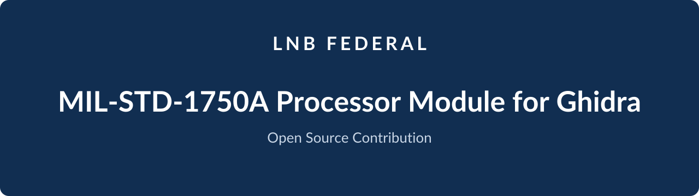

# MIL-STD-1750A Processor Module for Ghidra

## 1. Overview

This repository contains a processor module (Ghidra extension) for the MIL-STD-1750A instruction set architecture,
developed by LNB Federal Corporation and released under the Apache License 2.0. The module enables the disassembly,
decompilation and emulation of MIL-STD-1750A software in Ghidra, including software that uses expanded memory
addressing. It is written from the public copy of the standard, MIL-STD-1750A (USAF), dated 2 July 1980, with
Notice 1, dated 21 May 1982. The same module is submitted for inclusion in Ghidra as NationalSecurityAgency/ghidra
pull request #10241.

## 2. About Ghidra

Ghidra is a software reverse engineering framework created and maintained by the Research Directorate of the National
Security Agency. It disassembles and decompiles compiled programs, so that analysts can understand software for which
no source code is available: to find vulnerabilities, analyze malicious code, verify what delivered software does and
support systems whose original source has been lost. The National Security Agency released Ghidra to the public in
2019 under the Apache License 2.0.

Ghidra understands a processor through a module written in its SLEIGH processor specification language, and it ships
with modules for dozens of architectures, from x86, ARM and PowerPC to the 6502 and Z80. MIL-STD-1750A is not among
them, so programs written for 1750A computers could not be disassembled or decompiled in Ghidra. This module adds that
processor.

## 3. About MIL-STD-1750A

MIL-STD-1750A defines a 16-bit computer instruction set architecture, consisting of required and optional
components. It defines the instruction set and its behavior; it does not define how a processor implements it. The
U.S. Air Force published the standard in 1980. Processors conforming to it are used in military aircraft and
spacecraft, including the F-16 Digital Flight Control System and Fire Control Computer, the AH-64D Apache Longbow,
NASA Cassini, Landsat 7 and Mars Global Surveyor, and ESA Rosetta, Mars Express and Venus Express (source: Wikipedia,
MIL-STD-1750A). These programs are named for identification only.

The principal characteristics of the architecture are:

- Sixteen general registers of 16 bits each; register pairs and triples hold 32-bit integers and floating point
  values.
- Word-addressed memory of 64K 16-bit words. Expanded memory addressing (paragraph 4.5.2 of the standard) maps this
  logical space onto up to 1M words of physical memory through 512 page registers, organized in 16 groups.
- 32-bit and 48-bit floating point formats, each with a two's complement mantissa and exponent.
- One- and two-word instructions with register, direct, indexed, indirect, immediate, base relative and instruction
  counter relative addressing.
- Sixteen prioritized interrupts with a vector table at locations 20 through 3F, and the XIO and VIO instructions
  for input and output.

## 4. Purpose

MIL-STD-1750A is an architecture of the early 1980s. No new system is designed around it today: later avionics and
spacecraft computers moved to architectures such as PowerPC and SPARC, and few engineers still working know the
instruction set. The users of this module are few, and LNB Federal Corporation built it knowing that its audience is
small.

The systems built in that period, however, are still flown, maintained and modified. Military aircraft, weapon
systems and spacecraft are designed for service lives measured in decades, and their mission computers are rarely
replaced while they still meet their requirements. Every change to such a system, whether a corrected fault, a new
capability, a fix for an obsolete part or a port to a new processor, requires engineers to understand the software
that runs on it today.

The sustainment of these systems often depends on knowledge that is disappearing: original source code and design
records, and compilers, assemblers and simulators from the 1980s and 1990s that are no longer supported and may run
only on obsolete host computers. When the delivered program is the only authoritative record of what a system does,
analysis of that program is the engineering basis for every decision about it.

This module gives that analysis a current, open and verifiable tool. Its specification is written from the standard
and defines the exact effect of every instruction, so each disassembly, decompilation and emulation step can be
traced to a section of MIL-STD-1750A and checked independently. Results are reproducible on any computer that runs
Ghidra, and section 9 records how they were checked against the standard and against independent tools.

Government and defense organizations can review legacy software with the same tool, workflow and assurance practices
they already apply to modern processors: to plan a migration, assess the risk of a change, investigate an anomaly or
confirm what a system does before it returns to service. Because the module is open source under the Apache License
2.0, an organization can inspect it, adapt it to its own hardware and keep it for as long as its systems remain in
service, without depending on a vendor.

## 5. Applications

- Satellites and spacecraft. Radiation-hardened MIL-STD-1750A processors flew in satellites and spacecraft for
  decades, and some of those systems remain in operation. Engineers can read their flight software in Ghidra.
- Military avionics. Avionics and weapons computers built to the standard remain in service in aircraft and weapon
  systems, where their software must still be understood and maintained.
- Legacy system sustainment. When source code, documentation or the original development tools are lost, analysis of
  the delivered program is the way to maintain, port or replace a system that is still needed.
- Security and assurance. Analysts can verify what delivered firmware does, look for vulnerabilities and check
  modified software before it returns to service, with the same Ghidra tools they use for every other processor.

## 6. Features

- Every instruction format and addressing mode of the base instruction set: integer, logical, shift, bit, branch,
  stack, byte and input/output instructions.
- 32-bit and 48-bit floating point, emulated according to the register transfer descriptions of section 5 of the
  standard.
- XIO commands defined by the standard are displayed by name. The mandatory commands that act on the interrupt mask,
  status word, pending interrupt and fault registers are modeled.
- Two languages: `MIL-STD-1750A:BE:16:default` (64K-word logical memory) and `MIL-STD-1750A:BE:24:expanded` (20-bit
  physical memory and page registers).
- Labels for the reset entry point and for the interrupt linkage and service pointers (table VIII of the standard).
- An analyzer, "MIL-STD-1750A Interrupt Vectors", that follows the vector table and creates functions at the
  interrupt handlers and the sixteen BEX entry points. The analyzer does not act on a table whose new status words
  set the reserved bits 4 through 7.
- A manual index: each instruction opens the corresponding page of the standard.

## 7. Memory Model of the Expanded Language

In `MIL-STD-1750A:BE:24:expanded`, program memory is the 20-bit physical space. The page file (16 groups, each with an
instruction set and an operand set of 16 page registers) is modeled as the `pagefile` address space and is written
and read by the WIPR, WOPR, RIPR and ROPR commands. Operand references are mapped through the operand set of the group
selected by the address state (AS) field of the status word. Computed jumps and returns are mapped through the
instruction set of that group. Direct branch targets and return addresses remain in the 64K-word bank of the
instruction: logical page n of the code is physical page 16 x bank + n. This rule requires no configuration and gives
the same result in the disassembler, the decompiler and the emulator. The access lock and key and the execute and
write protect bits are not checked.

## 8. Installation and Building

1. Download the release archive for the installed Ghidra version from the Releases page of this repository. An
   archive is valid only for the Ghidra version for which it was built.
2. In Ghidra, select File > Install Extensions, add the archive and restart Ghidra.
3. Import a binary and select the language MIL-STD-1750A.
4. For the manual index, place the standard at `data/manuals/mil-std-1750a.pdf` in the installed extension. The
   standard is not distributed with this repository; a public copy is listed in section 16.

To build from source, run `gradle -PGHIDRA_INSTALL_DIR=<path to Ghidra>` in the repository root. The archive is
written to `dist/`.

## 9. Verification

The module was verified on Ghidra 12.2 as follows:

- Encodings from the tables of the standard decode to the mnemonic and operands given by the standard, in both
  languages.
- Every first instruction word was decoded and compared with the Rizin and Reko disassemblers; each difference was
  checked against the format tables of the standard.
- One-step emulation of every instruction form was compared with a reference model written from the register transfer
  descriptions of section 5 (integer, floating point, XIO register commands and page register commands), in both
  languages, with no differences.
- The 32-bit and 48-bit floating point formats were checked against the MIL-STD-1750A codec of NASA EdsLib: every
  floating point operand and result decodes to the same value, and the examples of tables III and IV of the standard
  encode identically.
- Programs from milstd1750tools (ladd, fft, base50, trigtst, hello) execute in step with the sim1750 simulator. The
  remaining differences are cases in which sim1750 departs from the standard: the carry bit, register wrap from R15
  to R0, out-of-range shift counts, and floating point overflow and underflow results.
- A program exercising expanded memory (page register writes, a WSW to another group, remapped loads and stores, a
  32-bit operand across a page boundary, and SJS and URS) executes in step with sim1750.
- Dhrystone from milstd1750tools, run on the expanded language with a startup sequence that maps group 1 as its
  target board would, executes in step with sim1750 through its startup copy between address states and into the
  benchmark; the only difference is the carry bit, as above.
- Direct branches, calls and returns in a code bank above the first 64K words execute in the emulator at the
  addresses shown by the disassembler.
- The module builds from the Ghidra source tree, and the release archive installs into an unmodified Ghidra 12.2.

## 10. Limitations

- Direct branch targets in the expanded language follow the 64K-word bank rule of section 7. For code whose pages are
  not mapped as one aligned 64K-word bank, direct branch targets follow the bank, not the page registers; computed
  jumps and returns are mapped through the page registers in all cases.
- In the expanded language, sequential execution past the end of a 64K-word bank continues at the next physical
  word, whereas the processor wraps the instruction counter to logical address 0000 and maps it through the page
  registers.
- The access lock and key and the execute and write protect bits of the page registers are not enforced.
- Optional XIO commands, other than the page register commands of the expanded language, are displayed by name but
  have no modeled effect.

## 11. Third-Party Materials

No third-party code is included in this repository. The simulators, disassemblers and libraries named in section 9
(milstd1750tools, Rizin, Reko and NASA EdsLib) were used for testing only, under their own licenses, and are not
distributed here.

## 12. No Endorsement

Ghidra is developed by the National Security Agency. References to the National Security Agency, the U.S. Air Force,
NASA, ESA or any other organization, program or product are for identification only and do not imply affiliation
with, or endorsement by, any of them.

## 13. Disclaimer of Warranty

This software is provided on an "AS IS" basis, without warranties or conditions of any kind, either express or
implied, including, without limitation, any warranties or conditions of title, non-infringement, merchantability or
fitness for a particular purpose. The user is solely responsible for determining the appropriateness of using the
software and assumes all risks associated with its use, as set out in sections 7 and 8 of the Apache License,
Version 2.0.

## 14. License

Licensed under the Apache License, Version 2.0 (the "License"); the software may not be used except in compliance
with the License. A copy of the License is provided in the `LICENSE` file of this repository.

## 15. Contribution

Contributed by Laxmi Narayan Behera, LNB Federal Corporation, as a volunteer open source contribution. This software
was not developed under, funded by or paid for under any contract.

## 16. Links

- LNB Federal Corporation: https://www.lnbfederal.com
- Project page: https://www.lnbfederal.com/open-source/ghidra-mil-std-1750a/
- Open source contributions of LNB Federal Corporation: https://www.lnbfederal.com/open-source/
- Releases: https://github.com/LNBFEDERAL/ghidra-mil-std-1750a/releases
- Ghidra pull request: https://github.com/NationalSecurityAgency/ghidra/pull/10241
- Ghidra proposal discussion: https://github.com/NationalSecurityAgency/ghidra/discussions/10102
- Ghidra: https://github.com/NationalSecurityAgency/ghidra
- MIL-STD-1750A, public copy: https://www.mssl.ucl.ac.uk/swift/docs/mil-std-1750a.pdf
- Apache License, Version 2.0: https://www.apache.org/licenses/LICENSE-2.0
